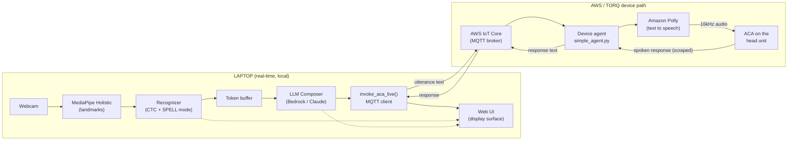
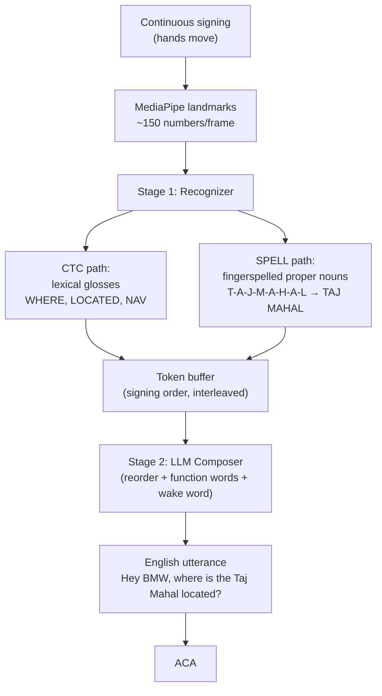
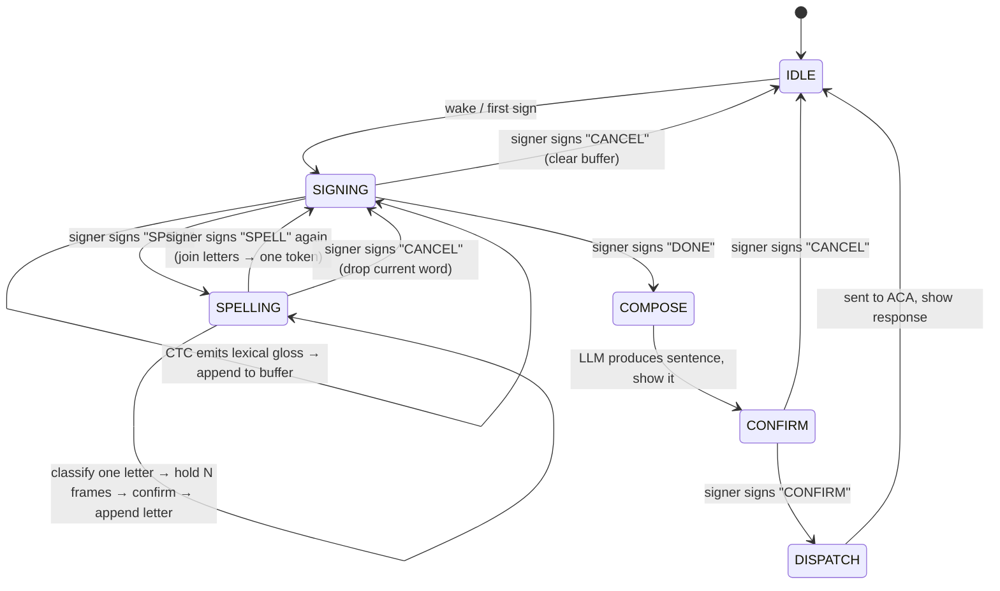
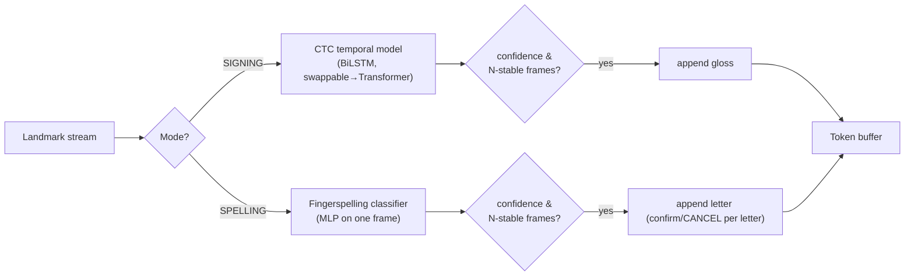
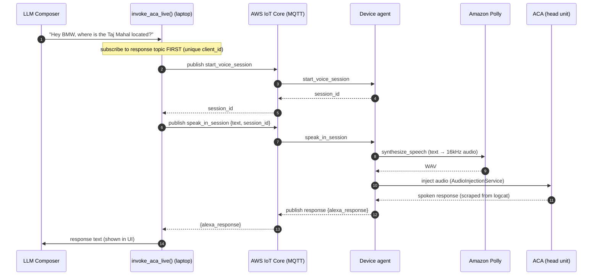
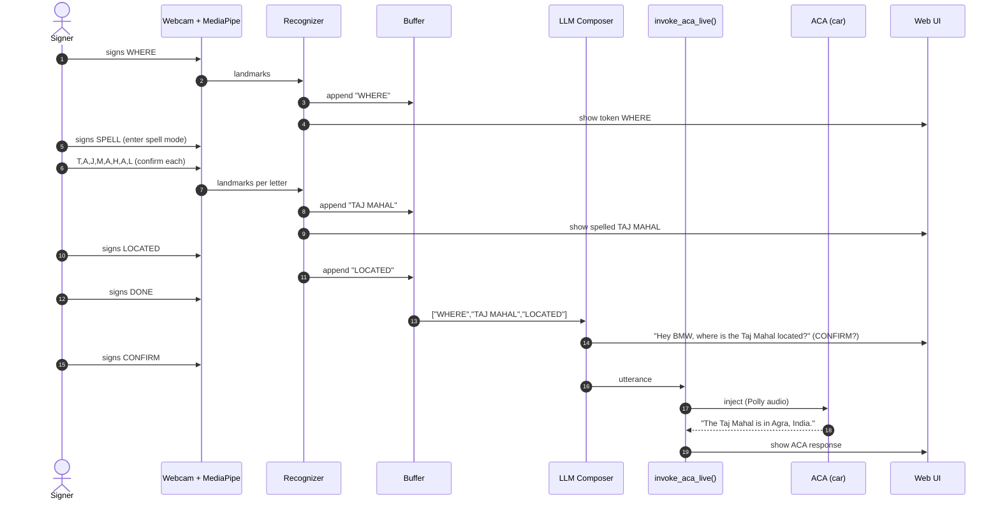
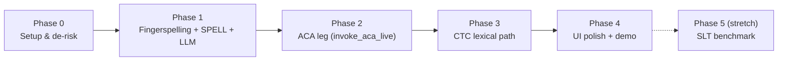

# Gesture-Driven ACA Control — Design Document

> **One-line summary:** Let a Deaf/mute driver control the in-car Alexa Custom Assistant (ACA) by signing. A webcam reads sign language, converts it to an English sentence in real time, and injects that sentence into ACA exactly the way the internal TORQ test system does — so it *feels like the signer is talking directly to the car*, not authoring a test.

**Status:** Design — approved in brainstorming, not yet implemented.
**Author:** (you)
**Audience:** Your hackathon team. This doc assumes **no prior knowledge** of ASL, ML, or the TORQ/ACA internals — every term is explained.
**Date:** 2026-07-14

---

## Table of Contents

1. [The problem & the idea](#1-the-problem--the-idea)
2. [Glossary — every acronym & term](#2-glossary--every-acronym--term)
3. [How to read this doc](#3-how-to-read-this-doc)
4. [System overview (the big picture)](#4-system-overview-the-big-picture)
5. [The two-stage core, explained from basics](#5-the-two-stage-core-explained-from-basics)
6. [Component-by-component design](#6-component-by-component-design)
7. [The combined recognizer: CTC + SPELL mode](#7-the-combined-recognizer-ctc--spell-mode)
8. [The LLM composer](#8-the-llm-composer)
9. [The ACA leg — how we reach the car](#9-the-aca-leg--how-we-reach-the-car)
10. [End-to-end walkthrough (with mermaid)](#10-end-to-end-walkthrough-with-mermaid)
11. [Sample queries](#11-sample-queries)
12. [Use cases](#12-use-cases)
13. [Alternatives considered](#13-alternatives-considered)
14. [Technology reference (from basics)](#14-technology-reference-from-basics)
15. [Data: what we need to train](#15-data-what-we-need-to-train)
16. [Demo safety & failure handling](#16-demo-safety--failure-handling)
17. [Scope: in / out (YAGNI)](#17-scope-in--out-yagni)
18. [Risks & open questions](#18-risks--open-questions)
19. [Action items](#19-action-items)
20. [Phased plan](#20-phased-plan)
21. [Training the models (step-by-step)](#21-training-the-models-step-by-step)

---

## 1. The problem & the idea

**Problem.** In-car voice assistants assume the driver can *speak*. A Deaf or non-verbal driver is locked out of the entire hands-free experience — navigation, music, calls, climate, vehicle status.

**Idea.** Replace the *voice* with *sign language*. A camera watches the driver's hands, a model converts the signing into an English sentence, and we feed that sentence into the real ACA the same way our internal test tooling (TORQ) does. The car answers out loud / on screen, exactly as if the driver had spoken.

**The one hard part.** Sending text to the car is *easy* (TORQ already does it). The hard, interesting part is **sign language → correct English sentence, in real time, reliably enough to demo live.** That is where 90% of this design's thought goes.

**Design stance.** We deliberately split "understand the signs" from "write good English," and we lean on a Large Language Model (LLM) to turn imperfect, grammar-free sign output into a clean sentence. This makes the system both more capable *and* more forgiving of recognition errors.

---

## 2. Glossary — every acronym & term

> Read this once; the rest of the doc uses these freely.

### Sign-language terms
| Term | Meaning |
|---|---|
| **ASL** | American Sign Language — a full natural language with its own grammar (not "English on the hands"). |
| **Sign / Lexical sign** | A single gesture that means a whole word/concept (e.g. the sign for "WHERE"). |
| **Fingerspelling** | Spelling a word **letter by letter** using the ASL manual alphabet. Used for proper nouns (names, places) because **ASL has no dedicated sign for most proper nouns** — they *must* be spelled. |
| **Gloss** | The written label of a sign, in CAPS. e.g. the sign meaning "where" is glossed `WHERE`. A gloss is *not* English grammar — it's just a tag for the sign. |
| **Manual alphabet** | The 26 hand shapes for A–Z. Note: **J and Z require motion**; the other 24 are static (single pose). |
| **Continuous signing** | Signing naturally, without pausing between signs (as opposed to one-sign-at-a-time). |

### Our system's terms
| Term | Meaning |
|---|---|
| **Recognizer** | Stage 1. Turns hand motion into a stream of tokens (glosses + spelled letters). |
| **Composer** | Stage 2. An LLM that turns the token stream into a proper English sentence. |
| **Token** | One item in the buffer — either a gloss (`WHERE`) or a completed spelled word (`TAJ MAHAL`). |
| **Buffer** | The ordered list of tokens collected during one query, before it goes to the LLM. |
| **SPELL mode** | A state the signer toggles (with a "SPELL" sign) to fingerspell a proper noun letter-by-letter. |
| **Wake word** | The phrase that activates the assistant (e.g. "Hey BMW"). We prepend it to every sentence. |

### Machine-learning terms
| Term | Meaning |
|---|---|
| **ML** | Machine Learning — software that learns patterns from example data instead of being hand-coded. |
| **Model** | The trained thing that makes predictions (here: hand-motion → gloss). |
| **Landmark / keypoint** | An (x, y, z) coordinate of a body point (e.g. a knuckle). MediaPipe outputs these. |
| **MediaPipe** | Google's free, real-time, on-device library that finds hand/body/face landmarks in a camera frame. Our "sensor." |
| **MediaPipe Holistic** | The MediaPipe pipeline that returns **hands + pose + face** landmarks together (~150 points/frame). |
| **MLP** | Multi-Layer Perceptron — the simplest neural network. Good for classifying **one frame** (a static pose → a letter). |
| **LSTM** | Long Short-Term Memory — a neural network that reads a **sequence** and remembers context. Good for signs that *move over time*. |
| **BiLSTM** | Bi-directional LSTM — reads the sequence forwards *and* backwards for better accuracy. |
| **Transformer** | A modern sequence model (the architecture behind LLMs). More powerful than LSTM but usually needs more data. |
| **CTC** | Connectionist Temporal Classification — a training/decoding technique that lets a model output a sequence of labels from continuous input **without needing to label which frame is which sign**. It's the trick that makes *continuous* signing possible. Explained in §5. |
| **CNN** | Convolutional Neural Network — a network that reads **images** (raw pixels). Used by the reference GitHub project; we use landmarks instead (more robust). |
| **Inference** | Running a trained model to get a prediction (as opposed to *training* it). |
| **Confidence** | How sure the model is about a prediction (0–1). We ignore low-confidence guesses. |

### Amazon / product terms
| Term | Meaning |
|---|---|
| **ACA** | Alexa Custom Assistant — an OEM-branded (e.g. BMW, Mahindra) voice assistant that runs alongside Alexa in the car. **This is what we're controlling.** |
| **OEM** | Original Equipment Manufacturer — the carmaker (BMW, Mahindra). |
| **TORQ** | The ASV team's internal **test-automation platform** for the in-car assistant. It runs utterances on real head-unit devices and checks the assistant's response. We reuse its device-injection mechanism. |
| **Head unit** | The car's dashboard computer (the screen + compute that runs the assistant). |
| **AAOS** | Android Automotive OS — the Android variant that runs on many head units. |
| **Utterance** | One spoken command/question ("Hey BMW, play music"). |
| **Injection** | Feeding an utterance into the assistant's microphone pipeline as if it were spoken. TORQ does this with synthesized audio. |
| **Polly** | Amazon's Text-to-Speech (TTS) service. TORQ uses it to turn utterance *text* into *audio* before injecting. |
| **TTS** | Text-to-Speech — converts text into spoken audio. |
| **MQTT** | A lightweight publish/subscribe messaging protocol. The device agent listens for commands over MQTT. |
| **AWS IoT Core** | Amazon's managed MQTT broker; routes messages to/from devices. |
| **mTLS** | Mutual TLS — both client and server present certificates to authenticate. The device uses X.509 certs to connect to IoT Core. |
| **Device agent** | The program running on/next to the head unit (`simple_agent.py`) that receives commands and performs the injection. |
| **`speak_in_session`** | An **existing** device-agent command that takes a raw text string, synthesizes it with Polly, injects it into ACA, and returns ACA's response. **This is our entry point.** |
| **`invoke_aca_live()`** | *Our* thin wrapper module: `invoke_aca_live(text) → response`. Internally uses `speak_in_session` over MQTT. Named so the code reads like "invoke ACA directly." |
| **Bedrock** | AWS's managed service for calling foundation models (e.g. Claude). Our composer LLM runs here. |
| **SLT** | Sign Language Translation — the research field of translating signing into full sentences. Our "stretch" benchmark. |
| **Midway** | Amazon's internal single-sign-on auth. Needed to talk to TORQ services. (`mwinit` refreshes it.) |
| **ASV** | Amazon Smart Vehicles / Alexa Auto — the org that owns ACA and TORQ. |

---

## 3. How to read this doc

- If you know nothing about ML or ASL → read §2 (glossary), §4 (overview), §5 (the core explained simply), then §10 (walkthrough).
- If you're building a component → jump to §6 and §7–9.
- If you want the "why not X?" answers → §13 (alternatives).
- If you want to start working → §19 (action items) and §20 (plan).

---

## 4. System overview (the big picture)

The system has **three layers**: capture → understand → act.



**In words:**
1. **Capture (laptop):** the webcam frame goes to MediaPipe, which reduces the image to ~150 hand/body landmarks — tidy numbers, not pixels.
2. **Understand (laptop):** the Recognizer turns the landmark stream into **tokens** (glosses like `WHERE`, and spelled words like `TAJ MAHAL`). The LLM Composer turns those tokens into one clean English sentence with the wake word.
3. **Act (AWS):** `invoke_aca_live()` sends that sentence over MQTT to the device agent, which speaks it into ACA via Polly and scrapes ACA's response back. The Web UI shows every step.

**Why this shape?** Each layer is independently testable, and the "hard" layer (understand) is isolated so we can iterate on it without touching the car plumbing.

---

## 5. The two-stage core, explained from basics

The heart of the system is the **"understand" layer**, and it is split into two stages. Understanding *why* is the key to the whole design.

### Why not one model that goes video → English?

You *could* try a single model that watches signing and outputs English (this is "end-to-end SLT" — see §13, Alternative B). But those models are:
- **Heavy** (won't run smoothly on a laptop),
- **Inaccurate** on open-domain signing (they often produce garbled English), and
- **Data-hungry** (need huge labeled datasets to train).

So instead we split the job into two stages that each already work well:

### Stage 1 — Recognition (signs → tokens)

This stage answers: *"which known signs did the hands just make?"* It outputs **glosses** — bare labels, in signing order, with no grammar:

```
hands  →  ["WHERE", "TAJ MAHAL", "LOCATED"]
```

That's not English yet. `WHERE TAJ-MAHAL LOCATED` is ASL-style word order with no function words. But it's a **faithful, machine-readable transcript** of what was signed.

**How Stage 1 works (the landmark trick).** We never feed raw camera pixels to our model. First, **MediaPipe** converts each frame into ~150 landmark numbers (knuckles, fingertips, wrist, etc.). This is huge for us:
- The model only has to learn from **63–150 numbers**, not a full image → it can be **tiny and fast** (real-time on a laptop).
- Landmarks are **robust to lighting, background, and skin tone** — the model sees a skeleton, not a photo.

### The CTC idea (why continuous signing is even possible)

Here's the problem CTC solves. If someone signs continuously for 3 seconds at 30 frames/second, that's 90 frames. We know they signed `WHERE LOCATED`, but we **don't know which frames** were "WHERE" and which were "LOCATED" (and many frames are just transitions between signs). Hand-labeling every frame would be impossibly tedious.

**CTC (Connectionist Temporal Classification)** is a technique that lets the model learn from just the **ordered list of signs** (`["WHERE", "LOCATED"]`) *without* telling it which frame is which. It does this with two ideas:
1. A special **"blank" label** the model emits for "nothing / in-between" frames.
2. A **collapse rule**: repeated labels and blanks are merged. So a raw per-frame output like
   `blank, WHERE, WHERE, WHERE, blank, blank, LOCATED, LOCATED, blank`
   **collapses to** `WHERE, LOCATED`.

So CTC turns a messy 90-frame stream into a clean 2-token sequence, and it can be trained on cheap labels (just the sign list per clip). This is what makes **continuous** signing tractable.

### Stage 2 — Composition (tokens → English)

This stage answers: *"what's the correct English sentence for these tokens?"* We hand the token buffer to an **LLM (Claude, via Bedrock)** with a prompt that tells it to:
- **Reorder** ASL word order into English word order,
- **Insert function words** ASL drops (is, the, a, in, to),
- **Constrain** the output to a sensible in-car command/question,
- **Prepend the wake word.**

```
["WHERE", "TAJ MAHAL", "LOCATED"]  →  LLM  →  "Hey BMW, where is the Taj Mahal located?"
```

**Why an LLM and not a rule-based template?** Because it does two things templates can't: it handles *any* combination of tokens gracefully, and it **repairs recognition errors** (e.g. a dropped or wrong gloss) into a plausible sentence. The LLM is both the translator *and* the safety net.

### The whole core in one picture



---

## 6. Component-by-component design

Each component is a small, independently testable unit. You can test any one with a canned input from the previous one.

| # | Component | Language | Responsibility | Input | Output | Depends on |
|---|---|---|---|---|---|---|
| 1 | **`capture/`** | Python | Grab webcam frames; run MediaPipe Holistic; emit landmark vectors | Webcam | Landmark sequence (per frame) | OpenCV, MediaPipe |
| 2 | **`recognizer/`** | Python | Landmark stream → token stream. Holds CTC model + fingerspelling classifier + SPELL-mode state machine + confidence/debounce gates | Landmark sequence | Tokens (glosses + spelled words) | trained model weights |
| 3 | **`composer/`** | Python | Token buffer → one English utterance (reorder, function words, domain, wake word) | Token list | Utterance string | Bedrock (Claude) |
| 4 | **`aca_client/`** (`invoke_aca_live`) | Python | Utterance string → inject into ACA via MQTT → return ACA's response. Wraps `speak_in_session` | Utterance string | ACA response text | AWS IoT SDK, device certs |
| 5 | **`orchestrator/`** | Python | The state machine tying it together: IDLE → SIGNING → (SPELL) → CONFIRM → DISPATCH → SHOW. Owns gates & fallbacks | events | drives 1–4 | components 1–4 |
| 6 | **`ui/`** | Web (HTML/JS + FastAPI/WebSocket) | Display surface: camera feed + landmarks overlay + live tokens + composed sentence + ACA reply + current mode | state stream | on-screen demo | FastAPI, WebSocket |
| 7 | **`slt_benchmark/`** *(stretch)* | Python | Offline: run a gloss-free SLT model on recorded clips → English, shown side-by-side as "future work" | recorded clip | English text | pretrained SLT checkpoint |

**Clean seams (interfaces):**
- `capture` → `recognizer`: a stream of landmark arrays. (Recognizer doesn't know about cameras.)
- `recognizer` → `composer`: a list of string tokens. (Composer doesn't know about ML.)
- `composer` → `aca_client`: one string. (aca_client doesn't know about LLMs.)
- `aca_client` → world: one response string. (Everything downstream is TORQ/ACA.)

Because the seams are plain data (arrays, string lists, strings), **any component can be swapped or tested in isolation** — e.g. type a token list by hand to test the composer without a camera.

### 6.1 Where the code lives (and what we must NOT touch)

**All of our code lives in a standalone project: `~/workplace/GestureACA/`.** It is **not** a Brazil package and **not** inside any TORQ package. Reasons:

- **Our code runs on the laptop; `simple_agent.py` runs on the device.** They are different machines with different jobs. Our `aca_client` is a *separate MQTT publisher* that talks *to* the already-installed device agent — it reuses the `speak_in_session` message shape but does **not** live inside `simple_agent.py`.
- **`~/workplace/torqai/*` and `~/Downloads/scaletest-device-agent/` are NOT ours.** `torqai` packages are owned by the ASV-Gravity team (`asv-ind-gravity`) with their own pipelines/CRs; the device agent is deployed on the head unit. We **read them for reference only** — we do not modify, commit into, or redeploy them for this POC. That is precisely the "no device/cloud change" path we chose (§13.5).
- **A hackathon Python + web-UI project has no reason to be a Brazil package.** Standalone = clone, `pip install`, run.

```
   LAPTOP  —  our new code (GestureACA/)          DEVICE / head unit  —  NOT ours
┌────────────────────────────────────────┐    ┌─────────────────────────────────┐
│ capture/  recognizer/  composer/        │MQTT│  simple_agent.py                │
│ orchestrator/  ui/                      │───►│  (already installed & running;  │
│ aca_client/  (invoke_aca_live)  ────────┼────┤   listens for speak_in_session) │
└────────────────────────────────────────┘    └─────────────────────────────────┘
```

**The only things we consume from the TORQ world (both from outside, neither requiring edits):**
1. The MQTT `start_voice_session` / `speak_in_session` **message shape** (protocol), and
2. The **device certs** at `/etc/iot-agent/` (to authenticate our laptop MQTT client).

Proposed folder layout under `~/workplace/GestureACA/`:
```
GestureACA/
├── docs/specs/                # this design doc
├── capture/                   # webcam + MediaPipe → landmarks
├── recognizer/                # fingerspelling MLP + CTC BiLSTM + SPELL state machine + buffer
│   ├── fingerspell/           #   MLP model + weights
│   └── ctc/                   #   BiLSTM+CTC model + weights
├── composer/                  # Bedrock/Claude prompt → English utterance
├── aca_client/                # invoke_aca_live() MQTT publisher (reuses speak_in_session)
├── orchestrator/              # state machine + fallback ladder
├── ui/                        # FastAPI + WebSocket + web display
├── data/                      # recorded landmark datasets (fingerspell rows, CTC clips)
├── training/                  # train_fingerspell.py, train_ctc.py, collect_data.py
└── slt_benchmark/             # (stretch) offline gloss-free SLT comparison
```

> If this graduates to a real internal tool post-hackathon, `invoke_aca_live` becomes an MCP tool inside `TorqAIMCPServer` (§13.5 productionization) — but that is out of scope here.

---

## 7. The combined recognizer: CTC + SPELL mode

This is the component that realizes your key insight: **CTC handles signed keywords, SPELL mode handles proper nouns, both feed one buffer in signing order.**

### Why we need both

- **Lexical glosses** (`WHERE`, `NAV`, `CALL`, `LOCATED`, `NEAR`) — recognized by the **CTC continuous path**. Fast, natural, grammar-free.
- **Proper nouns** (`Taj Mahal`, `Cubbon Park`, `Mom`) — **have no ASL sign**, so they must be **fingerspelled** letter-by-letter. Fingerspelling is most reliable with a **per-letter confirm** (the ~98%-accuracy approach from the reference GitHub project), not continuous CTC.

So we put **each technique on the part it's best at.**

### The SPELL-mode state machine



### How token order works (your question, answered precisely)

There is **one buffer**, and **every token is appended the instant it's recognized** — so the buffer order = **the order the signer signed**, with CTC glosses and spelled words **interleaved on a single timeline**. It is **NOT** "all CTC first, then all spelling."

Example — signer signs `WHERE → SPELL T-A-J-M-A-H-A-L → LOCATED`:

```
t0  WHERE      (CTC)          buffer = ["WHERE"]
t1  SPELL      (toggle on)    buffer = ["WHERE"]           (enter SPELLING)
t2  T,A,J,...  (per-letter)   collecting: "TAJMAHAL"
t3  SPELL      (toggle off)   buffer = ["WHERE", "TAJ MAHAL"]   (letters joined, appended here)
t4  LOCATED    (CTC)          buffer = ["WHERE", "TAJ MAHAL", "LOCATED"]

final buffer = ["WHERE", "TAJ MAHAL", "LOCATED"]   ← interleaved, in signing order
```

The spelled proper noun sits **exactly where the signer placed it** in the stream. The LLM then reorders/repairs into English — and because the LLM *always* does ASL→English reordering, the system is **robust even if the signing order isn't perfect English**.

### Recognizer internals



- **CTC temporal model:** BiLSTM over landmark windows (swappable to a small Transformer if we get more data). Emits lexical glosses.
- **Fingerspelling classifier:** a simple MLP over a single frame's hand landmarks → one letter. Uses the **confusable-set trick** from the reference project (extra small classifier for look-alike letters like `M/N/S`, `D/R/U`, `T/K`) to push accuracy.
- **Gates (shared):** a **confidence threshold** (ignore unsure guesses) and an **N-stable-frames debounce** (only accept a token after it's been the top guess for N consecutive frames). These prevent flicker and misfires.

### Build order (reliable part first)

1. **Fingerspelling + SPELL mode + confirm** — this alone demos `NAV → spell CUBBON PARK`.
2. **CTC lexical path** — adds `WHERE / NEAR / LOCATED …` keyword frames → unlocks the "where is the Taj Mahal" class.
3. Wire both into the shared buffer.

So the demo **never depends on the hardest piece (CTC) landing** — the per-sign path is a complete demo on its own.

### What the user experience is like WITHOUT CTC

A subtle but important point: **CTC changes *how you enter* signs, not really *what you can express*.** What's expressible is set mostly by the **LLM composer**, which builds a sentence from whatever tokens reach the buffer — so dropping CTC does *not* shrink the query vocabulary much. What it changes is the **interaction feel**: fluid signing vs. slow, mechanical one-at-a-time entry.

| Dimension | With CTC (continuous) | Without CTC (per-sign only) |
|---|---|---|
| **Rhythm** | Sign a phrase naturally, no pauses | Every sign: pose → hold N frames → CONFIRM → next. Stop-and-go. |
| **Speed** | "where's the nearest gas station" ≈ 2–3 s | Same phrase ≈ 15–20 s (4 signs × hold+confirm) |
| **Effort / fatigue** | Low — it's just signing | High — feels like a slow remote-control menu |
| **Naturalness** | Feels like *talking* | Feels like *typing* one word at a time |
| **Expressible queries** | Full set | **~Same set** — LLM still composes multi-token phrases, just entered slowly |
| **Reliability** | Lower (continuous is harder) | **Higher** — per-sign confirm is the ~98% path |
| **Recovery from misread** | Harder (flows through) | **Easier** — CANCEL per sign |
| **Proper nouns** | Unaffected (already per-letter) | Unaffected |
| **Core accessibility value** | ✅ | ✅ still fully present |

**Before/after — "Where's the nearest gas station?"**
- *With CTC:* fluidly sign `NEAR GAS STATION WHERE` in one motion (~3 s).
- *Without CTC:* `NEAR`→hold→CONFIRM→`GAS`→hold→CONFIRM→`STATION`→hold→CONFIRM→`WHERE`→hold→CONFIRM→DONE. Same sentence reaches ACA, ~4× slower and mechanical.

**"Navigate to Cubbon Park" (headline flow) barely changes** — it was already one command sign + per-letter spelling, so CTC adds almost nothing. This is why Phase 2 (per-sign only) is already a complete demo.

**Bottom line:** without CTC you still have a working, valuable, more-reliable product and the whole accessibility mission holds. What you lose is (1) the **on-stage "wow"** of natural signing, (2) **fluency/dignity** (natural signing *is* the user's language; token-by-token entry is a downgrade to data entry), and (3) **practicality for longer queries** (they become tedious enough that users avoid them). That trade is exactly why CTC is staged as **Phase 3**, not a Phase 0 dependency — if time runs out, ship without it and lead with the navigation flow.

---

## 8. The LLM composer

**Input:** the token buffer (e.g. `["WHERE", "TAJ MAHAL", "LOCATED"]`).
**Output:** one English utterance, wake-word-prefixed (`"Hey BMW, where is the Taj Mahal located?"`).

**The LLM does three jobs in one call:**
1. **Reorder** — ASL is topic-comment / often verb-final; English is subject-verb-object. The LLM rewrites word order.
2. **Insert function words** — ASL drops *is/the/a/to/in*; the LLM adds them.
3. **Prepend wake word** — read from device config (`Hey BMW` / `Hey Mahindra`), because ACA needs it to trigger.

**Prompt sketch (illustrative):**
```
You are converting American Sign Language glosses from a driver into ONE natural
English command or question for an in-car assistant.
- Input is an ordered list of ASL glosses; UPPERCASE multi-word tokens are proper
  nouns that were fingerspelled (treat as-is).
- Reorder into natural English and add missing function words (is, the, a, to, in).
- Output exactly one sentence, prefixed with the wake word "{WAKE_WORD}".
- If the glosses are ambiguous, produce the most likely in-car intent.
Glosses: {token_list}
```

**Why the LLM is also the safety net:** if Stage 1 drops or mis-recognizes a gloss, the LLM still produces a coherent sentence rather than passing garbage to the car. This is why we can demo confidently even with an imperfect recognizer.

**Model:** Claude via Amazon Bedrock. Latency is one API round-trip (typically sub-second for a short prompt), which is fine because it runs once per completed query, not per frame.

---

## 9. The ACA leg — how we reach the car

This is the part your notes already de-risked: **we produce text; TORQ turns it into audio and injects it.** We build **no audio plumbing.**

### What we discovered about TORQ

- ACA's only real input is **audio** (a microphone / SpeechRecognizer). There is **no "type text and get an answer" API.**
- TORQ's device agent (`simple_agent.py`) already has a command, **`speak_in_session`**, that takes a **raw text string**, synthesizes it with **Amazon Polly** (16 kHz audio), injects it into ACA's mic pipeline (via an Android `AudioInjectionService`), then **scrapes ACA's spoken reply from the device logs** and returns it.
- The device is reached over **MQTT** through **AWS IoT Core**, authenticated with **X.509 certificates**. Your laptop is *already provisioned as a device* with those certs present locally.
- Crucially: this path **does not** create a test case, write to any database, store artifacts, or run an evaluation. It's a direct inject-and-return. (All that test-case machinery lives on a *different* path — `/execute-test` — which we deliberately **do not** use.)

### Our approach: `invoke_aca_live()` — a thin wrapper (chosen)

We wrap the existing `speak_in_session` command in a small local module named `invoke_aca_live(text) → response`, so **the code reads like "invoke ACA directly"** and the demo *feels* like signing talks straight to the car — not like authoring a test.

- **No cloud redeploy.** We call the *existing* device command over MQTT from the laptop, using the certs already present. Nothing in TORQ's cloud is modified.
- If we later want it as a first-class internal tool, the same module drops into `TorqAIMCPServer` as a proper MCP tool (`invoke_aca_live`) — but that's optional and needs a service redeploy, so it's **out of scope** for the hackathon.



### Two things to verify on the day (empirical, not answerable from code)
1. The device's IoT **policy** allows the laptop cert to **publish** on the command topic (not just subscribe).
2. Use a **distinct MQTT client_id** from the running agent, or IoT Core will disconnect one of them (duplicate-client-id takeover).

---

## 10. End-to-end walkthrough (with mermaid)

Full lifecycle for: **signer asks "where is the Taj Mahal located?"**



---

## 11. Sample queries

> "Query" = what the signer expresses → what we send to ACA. Format below: **[what they sign] → sentence sent → expected ACA behavior.**

### A. Single command sign (no spelling) — most reliable
| Signs | Utterance sent | ACA does |
|---|---|---|
| `MUSIC` | "Hey BMW, play some music" | starts music |
| `STATUS` | "Hey BMW, how much fuel do I have?" | reads fuel level |
| `CLIMATE` `HOT` | "Hey BMW, increase the temperature" | raises AC temp |
| `CANCEL-NAV` | "Hey BMW, cancel navigation" | stops route |

### B. Command sign + fingerspelled slot — the headline flow
| Signs | Utterance sent | ACA does |
|---|---|---|
| `NAV` `SPELL C-U-B-B-O-N P-A-R-K` | "Hey BMW, navigate to Cubbon Park" | starts navigation |
| `CALL` `SPELL M-O-M` | "Hey BMW, call Mom" | places call |
| `NAV` `SPELL A-I-R-P-O-R-T` | "Hey BMW, navigate to the airport" | starts navigation |

### C. Continuous multi-sign phrase (CTC) — richer queries
| Signs | Utterance sent | ACA does |
|---|---|---|
| `NEAR` `GAS` `STATION` `WHERE` | "Hey BMW, where's the nearest gas station?" | POI search |
| `TRAFFIC` `HOW` | "Hey BMW, how's the traffic?" | traffic report |
| `WEATHER` `TODAY` | "Hey BMW, what's the weather today?" | weather |

### D. Continuous + spelled proper noun (the full combined power)
| Signs | Utterance sent | ACA does |
|---|---|---|
| `WHERE` `SPELL T-A-J-M-A-H-A-L` `LOCATED` | "Hey BMW, where is the Taj Mahal located?" | general-knowledge answer |
| `WHO` `SPELL E-I-N-S-T-E-I-N` | "Hey BMW, who is Einstein?" | general-knowledge answer |
| `NAV` `SPELL H-A-M-P-I` `HISTORY` | "Hey BMW, tell me the history of Hampi" | knowledge / POI |

---

## 12. Use cases

1. **Accessibility (the core mission).** A Deaf or non-verbal driver operates the assistant hands-free-equivalent — navigation, calls, music, climate, vehicle status — without speaking. Independence and safety (eyes-on-road) parity with hearing drivers.
2. **Noisy-environment control.** Even hearing users benefit when voice fails: loud highway, open windows, music blasting, kids in the back. Signing works where the mic can't hear.
3. **Privacy.** Commands that a user doesn't want spoken aloud (calling a contact, an address) can be signed.
4. **Passenger assistance.** A passenger can sign to the car without interrupting a driver's call or conversation.
5. **Internal capability demo (for the org).** Shows ACA can be driven by *any* text source, and validates the TORQ injection path as a reusable "give ACA a sentence, get a response" primitive — useful beyond this project.
6. **Research platform.** The recorded landmark dataset + benchmark harness (stretch) becomes a starting point for a real in-car SLT effort.

---

## 13. Alternatives considered

We evaluated real alternatives at each decision point. This section records **what we rejected and why**, so the team understands the reasoning (and can revisit if constraints change).

### 13.1 Sign → English model architecture

| Option | What it is | Why not (for this POC) |
|---|---|---|
| **A. Hybrid: recognition + LLM composer** ✅ **chosen** | Landmark recognizer emits glosses; LLM writes the sentence | — (this is our design) |
| **B. End-to-end gloss-free SLT** (Sign2GPT, GFSLT-VLP, SignLLM) | One neural model, video → English | Heavy (won't run real-time on a laptop), low accuracy on open-domain ASL (garbled English), needs large labeled data + training time. **Kept as an offline "future work" benchmark only.** |
| **C. Landmark seq2seq Transformer** | Encoder-decoder, landmarks → English, trained on car-domain sentences | Needs in-hackathon data collection + training; generalizes only to trained sentence patterns. Lighter than B but still too much for the timebox. |

### 13.2 Recognizer style (within the chosen hybrid)

| Option | What it is | Why not |
|---|---|---|
| **Per-sign only** | One sign at a time, confirm-to-append | Can't express natural multi-sign phrases; loses the "continuous / general question" story. |
| **Continuous CTC only** | Everything continuous | Weak at proper nouns (which *must* be fingerspelled); no per-letter recovery; more data. |
| **Combined (CTC + SPELL mode)** ✅ **chosen** | CTC for keywords, per-letter SPELL for proper nouns, unified buffer | — (best of both; each technique on its strength). |

### 13.3 Combining mechanism (how to switch spelling vs lexical)

| Option | What it is | Why not |
|---|---|---|
| **Explicit SPELL mode** ✅ **chosen** | A "SPELL" sign toggles per-letter mode | — (simplest, no extra model, most demo-safe). |
| **Auto-detect router** | A classifier decides fingerspelling vs lexical per segment | Extra model to train; can mis-route. Good future upgrade. |
| **Unified CTC vocabulary** | One CTC model outputs letters *and* glosses interleaved | Needs interleaved-labeled continuous clips — heaviest data cost, highest risk. Aspirational future architecture. |

### 13.4 Input representation

| Option | Why not |
|---|---|
| **Raw pixels + CNN** (like the reference GitHub repo) | Brittle to lighting/background/skin tone; confines hand to a fixed box; heavier. **We use MediaPipe landmarks** (robust, tiny, fast). We *do* borrow the repo's confusable-set accuracy trick and its data-collection scaffold. |

### 13.5 ACA injection tap point

| Option | What it is | Why not |
|---|---|---|
| **`invoke_aca_live()` wrapper over existing `speak_in_session`** ✅ **chosen** | Laptop MQTT client reusing the existing device command | — (no redeploy, feels direct, drops into an MCP tool later). |
| **New MCP tool in `TorqAIMCPServer`** | Add `invoke_aca_live` as a real internal tool | Needs AgentCore image rebuild + redeploy + IAM/certs. Heavier; deferred as "productionization." |
| **Modify the ScaleTest `/execute-test` workflow** | Add a "direct mode" to TORQ's core execute path | Highest blast radius on shared beta infra; deploy rights; riskiest for a hackathon. |
| **Create + execute a real test case** | Use the standard TORQ test flow | Creates DB/results artifacts, response comes back async — *feels like authoring a test*, the opposite of "direct invocation." Explicitly rejected per project intent. |

### 13.6 Compute location

| Option | Why not |
|---|---|
| **Cloud GPU inference** | Adds network latency + AWS setup; unnecessary since landmark models are tiny. |
| **On-device (Raspberry Pi / head unit)** | Deployment overhead beyond hackathon scope. |
| **Laptop webcam + local compute** ✅ **chosen** | Simplest, real-time, self-contained for a demo. |

---

## 14. Technology reference (from basics)

For teammates new to any piece.

### MediaPipe (our "eye")
- Google's free, real-time library. Give it a camera frame; it returns the (x, y, z) positions of hand/body/face points.
- **Holistic** = hands + pose + face together (~150 points).
- Runs on CPU in real time. It does the hard computer-vision; it does **not** know what a sign *means* — that's our model's job.

### Neural networks used (from simplest to most capable)
- **MLP** — takes a fixed set of numbers (one frame's landmarks) → a label. We use it for **static fingerspelling** (one pose → one letter).
- **LSTM / BiLSTM** — takes a *sequence* of frames and remembers context → good for **moving signs**. BiLSTM reads both directions for accuracy. This is our **CTC continuous** model.
- **Transformer** — a more powerful sequence model (what LLMs are built on). Optional upgrade for the continuous model if we get more data.
- **CNN** — reads raw images. *Not* used (we use landmarks), but it's what the reference GitHub project uses.

### CTC (the continuous-signing enabler)
- Lets a sequence model output a list of labels from continuous input **without frame-by-frame labels**.
- Uses a **blank** label + a **collapse rule** (merge repeats & blanks). See §5 for the worked example.

### LLM / Bedrock / Claude (our "translator")
- An **LLM** is a large language model that generates text. **Claude** is Anthropic's LLM; **Bedrock** is the AWS service that lets us call it.
- We use it once per query to turn glosses → a clean English sentence (reorder + function words + wake word), and it repairs recognition errors.

### The car-injection stack
- **MQTT / AWS IoT Core** — the messaging system to reach the device.
- **mTLS / X.509 certs** — how the laptop/device prove identity to IoT Core.
- **Device agent (`simple_agent.py`)** — receives commands, does the injection.
- **Amazon Polly (TTS)** — turns our utterance text into audio.
- **AudioInjectionService** — feeds that audio into ACA's mic pipeline on the head unit.
- **ACA** — the assistant that answers.

---

## 15. Data: what we need to train

**Two models need data; both are small because they see landmarks, not pixels.**

1. **Fingerspelling classifier (MLP)** — the easy one.
   - 24 static letters (drop **J** and **Z** — they need motion; avoid demo words containing them, or add them later as tiny LSTMs).
   - Data = many landmark snapshots per letter. Self-recorded is fast; can supplement with public datasets.
   - The reference GitHub project hit ~98% on A–Z with a self-built set — strong evidence this half works.

2. **CTC continuous model (BiLSTM)** — the harder one.
   - Vocabulary = our chosen lexical glosses (~15–30 signs: `NAV, MUSIC, CLIMATE, CALL, STATUS, WHERE, WHO, NEAR, LOCATED, TRAFFIC, WEATHER, HOW, TODAY, SPELL, CONFIRM, CANCEL, DONE, …`).
   - Data = short **clips** of continuous signing, each labeled only with its **ordered gloss list** (CTC doesn't need per-frame labels).
   - Realistically tens of clips per gloss; augment (mirror, jitter, speed) to multiply.

**Data-collection scaffold:** adapt the reference project's `FoldersCreation.py` / `TrainingDataCollection.py` loop, but **save landmark vectors instead of thresholded images**.

**Vocabulary is hand-defined by us** (a fixed list of gloss labels). The models learn the *mapping* from motion to those labels; they can never output a label outside the list. Proper nouns are handled by spelling, not by the vocabulary.

---

## 16. Demo safety & failure handling

Because this hits **real ACA**, we design so a misread never fires a bad command and the demo never dies.

- **CONFIRM gate** before every dispatch — the composed sentence is shown; nothing goes to ACA until the signer signs `CONFIRM`. A misread can't auto-fire.
- **CANCEL** sign — clears the buffer (or drops the current spelled word) instantly. Fast recovery from any misread.
- **Confidence threshold + N-stable-frames debounce** — the recognizer only accepts a token it's sure about and that's been stable for N frames. Kills flicker/misfires.
- **Fallback ladder for the ACA leg:**
  1. Real ACA on the device (happy path).
  2. If the device is busy/unreachable, `invoke_aca_live()` returns a clearly-labeled **stub response** so the pipeline still shows an answer on screen.
  3. Last-good cached response for the scripted demo queries.
  The UI **labels which mode** it's in, so there's no pretending.
- **Independent stages** — camera, recognizer, composer, and ACA client each fail independently; the UI shows partial progress (e.g. tokens recognized even if ACA is down).
- **Wake-word from config** — matches whatever the provisioned device expects (BMW / Mahindra).

---

## 17. Scope: in / out (YAGNI)

**In scope (hackathon):**
- MediaPipe capture; fingerspelling MLP + SPELL mode; CTC lexical path (staged second); LLM composer; `invoke_aca_live()` over MQTT to real ACA; Web UI; CONFIRM/CANCEL safety; the sample queries in §11.

**Out of scope (deliberately):**
- Open-domain continuous translation in the live loop (that's the offline benchmark).
- J / Z motion letters (v1).
- On-device / Raspberry Pi deployment.
- New MCP tool + AgentCore redeploy (the "productionized" tap point).
- Modifying TORQ's shared `/execute-test` workflow.
- Any audio plumbing (Polly/injection is TORQ's job).
- Retraining or modifying ACA itself.

**Stretch (only if time):**
- Gloss-free SLT (Alternative B) run **offline** on 3–5 recorded clips, shown side-by-side as "the research frontier."

---

## 18. Risks & open questions

| # | Risk / question | Impact | Mitigation |
|---|---|---|---|
| 1 | **CTC training data** is the biggest effort; may not reach good accuracy in time | Continuous queries weak | Stage it: per-sign path is a complete demo alone; CTC is additive. |
| 2 | Laptop cert may lack **`iot:Publish`** on the command topic | Can't reach ACA from laptop | Verify day 1; fallback = run the client where publish is allowed, or the stub-response ladder. |
| 3 | **Duplicate MQTT client_id** disconnects the agent | Flaky injection | Use a distinct client_id (known fix). |
| 4 | Device provisioning / **allowlisting** for ACA | ACA won't answer | Confirm an allowlisted, provisioned IDLE device before the event (you indicated access is ready). |
| 5 | **`asv-mcp` MCP tools disconnected** this session | Can't test-inject via that tool right now | Not on our critical path (we use MQTT direct); reconnect only if we want to test via the tool. |
| 6 | Fingerspelling **look-alike letters** (M/N/S…) | Wrong destination | Confusable-set classifier + per-letter confirm + CANCEL. |
| 7 | Live **lighting/camera** differs from training | Recognition drops | Landmarks are lighting-robust; record some training data in demo conditions. |
| 8 | LLM **latency/availability** | Slow/failed compose | Runs once per query (not per frame); cache/stub for scripted demo. |

---

## 19. Action items

> Owner and due columns are placeholders — assign in the team kickoff.

### Setup & de-risking (do first)
- [ ] **Confirm ACA device access:** an allowlisted, provisioned, IDLE device is reachable; note its `thing_id` and wake word. *(Owner: —)*
- [ ] **Verify laptop MQTT publish:** confirm the laptop cert can `publish` to `device/{thing_id}/command` (and subscribe to `.../response`) using a **distinct client_id**. Do a manual `speak_in_session` round-trip with a canned string. *(Owner: —)*
- [ ] **Confirm Bedrock/Claude access** from the laptop (region, model id, creds). *(Owner: —)*
- [ ] **Lock the gloss vocabulary** (final list of lexical signs + command signs: SPELL/CONFIRM/CANCEL/DONE). *(Owner: —)*
- [ ] **Reconnect `asv-mcp`** only if we decide to test-inject via the tool (optional). *(Owner: —)*

### Build
- [ ] `capture/` — webcam → MediaPipe Holistic → landmark stream. *(Owner: —)*
- [ ] Data-collection tool — adapt the reference scaffold to save **landmarks** per class/clip. *(Owner: —)*
- [ ] Record + label **fingerspelling** data (24 letters). *(Owner: —)*
- [ ] `recognizer/` — fingerspelling **MLP** + confusable-set classifier + confidence/debounce gates. *(Owner: —)*
- [ ] `recognizer/` — **SPELL-mode state machine** + shared token buffer. *(Owner: —)*
- [ ] `composer/` — Bedrock/Claude prompt: glosses → English (+reorder, +function words, +wake word). *(Owner: —)*
- [ ] `aca_client/` — **`invoke_aca_live(text)`** MQTT client (subscribe-first, unique client_id) reusing `speak_in_session`. *(Owner: —)*
- [ ] `orchestrator/` — full state machine + fallback ladder. *(Owner: —)*
- [ ] `ui/` — camera feed + landmarks overlay + live tokens + composed sentence + ACA reply + mode indicator. *(Owner: —)*
- [ ] Record + label **CTC lexical** clips; train **BiLSTM+CTC**; wire into buffer. *(Owner: —)*

### Stretch
- [ ] `slt_benchmark/` — run a gloss-free SLT checkpoint offline on 3–5 clips; render side-by-side. *(Owner: —)*

### Demo prep
- [ ] Script the demo queries (§11 A→D) and rehearse CONFIRM/CANCEL recovery. *(Owner: —)*
- [ ] Record training data **in demo lighting**. *(Owner: —)*
- [ ] Prepare the fallback stub responses for scripted queries. *(Owner: —)*

---

## 20. Phased plan

The guiding principle: **each phase is independently demoable, and the demo never depends on the hardest piece (CTC) landing.**



### Phase 0 — Setup & de-risk
- Confirm device access, MQTT publish, Bedrock access; lock vocabulary.
- **Exit criterion:** a hand-typed string reaches real ACA via `speak_in_session` and returns a response; Claude reachable.

### Phase 1 — Fingerspelling + SPELL mode + LLM composer (the reliable core)
- Capture → landmarks → fingerspelling MLP → SPELL-mode buffer → LLM sentence.
- **Exit criterion:** signer fingerspells a word, LLM produces `"Hey BMW, navigate to <word>"` on screen (not yet to ACA).

### Phase 2 — ACA leg
- Wire the composer output to `invoke_aca_live()`; add CONFIRM gate + fallback ladder.
- **Exit criterion (MVP demo!):** signer signs `NAV + spell CUBBON PARK` → CONFIRM → **real ACA navigates**, response shown. *This alone is a complete, presentable demo.*

### Phase 3 — CTC lexical path (the "wow" upgrade)
- Record/label lexical clips; train BiLSTM+CTC; interleave into the buffer.
- **Exit criterion:** signer signs `WHERE + spell TAJ MAHAL + LOCATED` → "Hey BMW, where is the Taj Mahal located?" → ACA answers.

### Phase 4 — UI polish + demo rehearsal
- Landmarks overlay, live tokens, mode indicator, response panel; rehearse §11 queries + recovery.
- **Exit criterion:** the demo runs end-to-end, smoothly, with graceful recovery from a deliberate misread.

### Phase 5 — Stretch: SLT benchmark
- Offline gloss-free SLT on recorded clips, shown beside our output as "future work."
- **Exit criterion:** a side-by-side slide/screen comparing our hybrid vs. end-to-end SLT.

---

## 21. Training the models (step-by-step)

We train **two** models. They share the same front-end (webcam → MediaPipe → landmarks) but differ in **what you record**, **how you label**, and **the loss function**. Build, train, and test each **independently** before wiring them together.

### 21.0 Shared prerequisite (both models)

```
Webcam frame → MediaPipe → landmark vector
  • Fingerspelling: MediaPipe Hands    → 21 points × (x,y,z) = 63 numbers/frame
  • CTC:            MediaPipe Holistic  → hands + pose ≈ 150 numbers/frame
Normalize EVERY frame:
  • translate so the wrist is the origin (wrist-relative coordinates)
  • scale-normalize (divide by hand/body span)
  → makes the model invariant to where the hand is in the frame and how big it is
```

**Tooling:** Python, `mediapipe`, `opencv-python`, and **TensorFlow/Keras** *or* **PyTorch** (either works; Keras has the simplest built-in CTC + MLP paths). All training runs on a laptop — no cloud GPU needed (§13.6).

**Why normalization matters:** without it, the model would think "hand in the top-left" and "hand in the center" are different signs. Wrist-relative + scale-normalized landmarks make the *shape* the only thing that varies.

---

### 21.1 Model 1 — Fingerspelling classifier (MLP, static) — the easy one

This is a **per-frame classification** problem: one hand pose → one letter. No time dimension. Low risk; expect ~half a day, mostly recording.

**Step 1 — Define classes.** 24 static letters (drop **J, Z** — they require motion). Optionally add a `NOTHING` class for "no clear handshape."

**Step 2 — Collect data.** For each letter, hold the handshape and record many frames, varying angle/distance/hand slightly:
```
for each letter L in A..Z (skip J,Z):
    record ~300–500 frames while signing L
    for each frame:
        MediaPipe Hands → 63 numbers
        save a row: [63 features ..., label = L]
→ one table: N rows × 64  (63 features + 1 label)
```
This is the reference-repo's `TrainingDataCollection.py` loop **adapted to save landmark rows instead of thresholded images** (`training/collect_data.py`).

**Step 3 — Preprocess.** Normalize each row (§21.0). Shuffle. Split **70 / 15 / 15** → train / validation / test.

**Step 4 — Train the MLP.** Tiny network:
```
Input(63)
  → Dense(128, relu) → Dropout(0.3)
  → Dense(64,  relu)
  → Dense(24,  softmax)
loss = categorical cross-entropy | optimizer = Adam | ~20–50 epochs
```
Trains in **minutes** on a laptop CPU.

**Step 5 — Add the confusable-set trick** (the ~98% lever from the reference repo). ASL has notorious look-alike letters. After the main MLP, add tiny secondary classifiers **just** for the confusable groups: `{M, N, S}`, `{D, R, U}`, `{T, K}`. At inference, if the main model's top guess falls in a group, route the same 63 features to that group's specialist for the final decision.

**Step 6 — Evaluate & export.** Confusion matrix on the test split (check the look-alike groups specifically). Save weights → `recognizer/fingerspell/fingerspell_mlp.h5` (or `.pt`).

---

### 21.2 Model 2 — CTC continuous recognizer (BiLSTM, sequence) — the hard one

This is a **sequence-to-sequence** problem: a *clip* of continuous signing → an *ordered list* of glosses. **CTC is the technique that lets you skip per-frame labeling** (see §5 for the concept). Expect 1–2 days, dominated by clip recording/labeling — which is why it's **Phase 3**, not a Phase 0 dependency.

**Step 1 — Define the gloss vocabulary + BLANK.** e.g.
```
[NAV, MUSIC, CLIMATE, CALL, STATUS, WHERE, WHO, NEAR, LOCATED,
 TRAFFIC, WEATHER, HOW, TODAY, SPELL, CONFIRM, CANCEL, DONE, <BLANK>]
```
`<BLANK>` is CTC's special "nothing / in-between-signs" label — the model emits it for transition frames.

**Step 2 — Collect data (the key difference from Model 1).** Record **short continuous clips**, each labeled **ONLY** with its ordered gloss list — **no frame-level labels**:
```
clip_001  → ["NEAR", "GAS", "STATION"]
clip_002  → ["WHERE", "LOCATED"]
clip_003  → ["MUSIC"]
...
Run each clip through MediaPipe Holistic → a SEQUENCE of ~150-dim vectors:
  clip → [ frame_0(150), frame_1(150), ..., frame_T(150) ],  label = gloss list
```
Target **tens of clips per gloss**. Because glosses recombine across clips, ~15–30 glosses needs roughly **200–400 clips total**. This recording + labeling is the biggest time sink in the whole POC.

**Step 3 — Augment** (cheaply multiplies the dataset 3–5×):
- horizontal mirror (left/right-hand signers),
- small time-stretch (speed up / slow down the sequence),
- landmark jitter (tiny random noise),
- small rotation.

**Step 4 — Preprocess.** Normalize each frame (§21.0). Pad / bucket sequences to similar lengths so they batch together; keep a mask for padded frames.

**Step 5 — Build the model.**
```
Input(T × 150)
  → Masking()                       # ignore padded frames
  → BiLSTM(128, return_sequences=True)
  → BiLSTM(128, return_sequences=True)
  → TimeDistributed(Dense(vocab+1, softmax))   # per-frame prob over glosses + BLANK
```
(Swappable to a small **Transformer** encoder if we collect more data — §7.)

**Step 6 — Train with CTC loss.** This is the whole point: CTC loss takes `(per-frame predictions, target gloss list)` and sums over **all possible alignments** of frames→glosses — so you **never** tell it which frame is which sign.
- Keras: `tf.keras.backend.ctc_batch_cost`
- PyTorch: `torch.nn.CTCLoss`

**Step 7 — Decode at inference.** Run the model, then **CTC-decode** (greedy or beam search) and apply the **collapse rule** (merge consecutive repeats, drop BLANK):
```
raw per-frame: [BLANK, NEAR, NEAR, BLANK, GAS, GAS, GAS, BLANK, STATION, BLANK]
  → collapse   → ["NEAR", "GAS", "STATION"]
```

**Step 8 — Evaluate & export.** Metric = **gloss / word error rate (WER)** — edit distance between the predicted and true gloss lists on a held-out split. Save weights → `recognizer/ctc/ctc_bilstm.h5` (or `.pt`).

---

### 21.3 How the two models meet at runtime

- The **fingerspelling MLP** drives the **SPELL path** (per-letter, with confirm).
- The **CTC BiLSTM** drives the **SIGNING path** (continuous lexical glosses).
- Both append tokens to the **shared buffer** in signing order (§7).

Each can be trained and unit-tested completely on its own (feed the MLP a saved frame; feed the CTC model a saved clip) before the orchestrator wires them together.

---

### 21.4 Training summary

| | Model 1 — Fingerspelling | Model 2 — CTC continuous |
|---|---|---|
| **Type** | Per-frame classification | Sequence-to-sequence |
| **Network** | MLP (+ confusable-set) | BiLSTM (→ Transformer optional) |
| **Input** | 63 numbers (one frame) | T × ~150 (a clip) |
| **Label** | One letter per frame | Ordered gloss list per clip (no frame labels) |
| **Loss** | Cross-entropy | **CTC** |
| **Decode** | argmax | CTC decode + collapse |
| **Data effort** | ~half a day (easy) | 1–2 days (biggest time sink) |
| **Phase** | Phase 1 | Phase 3 |
| **Risk** | Low (~98% proven) | Medium–high |

---

*End of document.*
